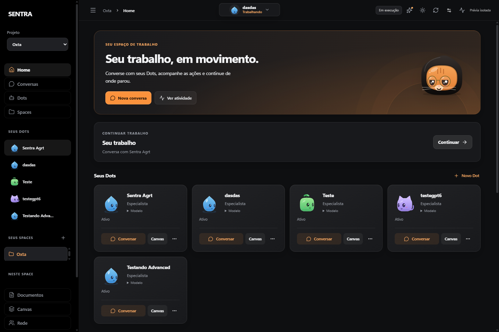
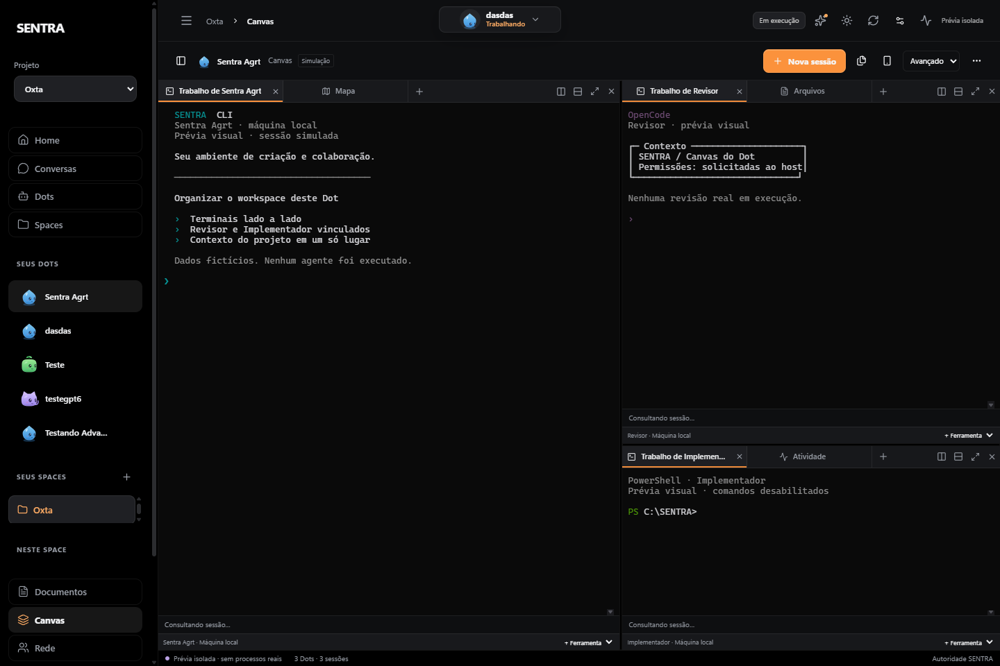
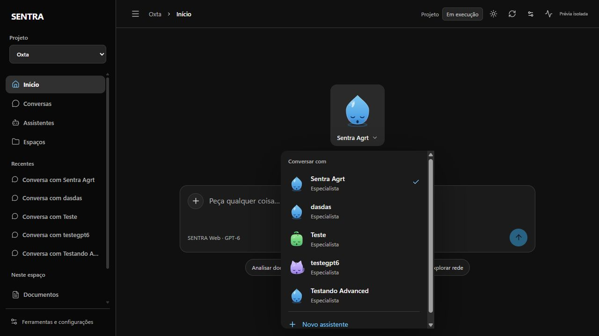
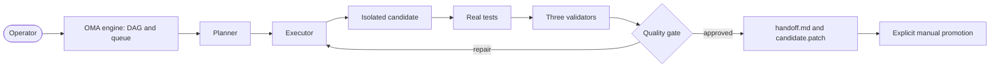

# SENTRA

**Auditable coordination and execution with AI agents.**

SENTRA brings Dots, permanent conversations, terminals, files, browser tools, and computer access into a shared workspace. Models propose actions; the runtime enforces permissions, records execution, and checks evidence. Model consensus alone does not establish correctness.

    

## Current status

- **Development preview:** the local Windows app includes the conversation-first Home, central Dot selector, contextual Canvas, durable terminal receipts and LAN/mobile integration. Selected functionality is validated; the complete product is not yet qualified as a stable release.
- **Current Windows installer:** the unsigned [Setup 1.0.2 preview](https://github.com/vitorGgC569/SENTRA/releases/tag/installer-preview-20261024-1) includes the October 24 interface and runtime fixes. Isolated installation, upgrade preservation, manual backup rollback and a real multi-Dot recovery journey passed. Stable qualification remains incomplete.
- **Known limits:** updated user-app Web login/inference, physical mobile/VPN tests, clean-OS installation and installed endurance remain open. The native WebView2 display passed; Electron timed out and the external activity bar is unqualified. MSI and automatic-update packages are excluded from publication. Read the [first-version acceptance review](docs/RELEASE_READINESS_2026-10-24.md).

Some linked documents and application labels remain in Portuguese. Dated reports identify the actual validation scope and remaining work.

## Downloads and application preview

Visit the [SENTRA download page](https://vitorggc569.github.io/SENTRA/) for current
availability, application screenshots and LAN pairing instructions. Android
preview downloads appear only after a signed standalone APK and its checksum
metadata have been published. iPhone installation remains unavailable until an
Apple distribution channel is configured. Physical-device qualification is a
separate milestone from producing a build.

Latest platform previews: [Windows Setup 1.0.2](https://github.com/vitorGgC569/SENTRA/releases/tag/installer-preview-20261024-1) and
[Android v8](https://github.com/vitorGgC569/SENTRA/releases/tag/mobile-preview-20261024-8), both built from source `62d61fa`.
The Windows Setup is unsigned; the Android APK uses the preserved preview key.

## SENTRA Desktop

Desktop brings **Dots**, conversations, **Spaces**, and authorized computer resources into a Windows interface. It starts with a dark theme and offers a light-theme option.

The following application previews were refreshed on October 24, 2026, using isolated demonstration data. They show the current Portuguese interface; they do not demonstrate live agent execution or full qualification of the Windows preview. [Screenshot provenance](site/assets/provenance.json).

### Start with your Dot

A focused conversation entry, project navigation and a central assistant selector:



### Dot Canvas

Tabs and split terminal panels inside a Dot's workspace:



### Choose your assistant

Click the central Dot to select another assistant or create a new one. Your draft stays in place:



The [historical October 13 presentation video](docs/media/2026-10-13/sentra-apresentacao.mp4) shows an earlier interface, including a setup preview rather than a completed installation.

### Choose your entry point

Start with one surface, confirm it works, and enable other integrations as needed.

| Surface | Purpose | First step |
|---|---|---|
| **SENTRA Desktop** | Conversations, Dots, installation, policies, and health | Open Desktop and complete **Quick Start** |
| **SENTRA CLI** | Terminal conversations, tools, and agent coordination | Run `sentra-cli.cmd` from the checkout or installed `sentra-cli.exe` |
| **Codex + Web Models** | ChatGPT/Gemini Web models through the local gateway | **Web Models → Abrir interface Web → Conectar Codex** |
| **ChatGPT app/plugin** | Calling the local MCP through outbound HTTPS | Connect **Secure MCP Tunnel**, then authorize the MCP app in ChatGPT |
| **Edge extension** | Operating an eligible existing browser tab | Enable the extension through Desktop's Quick Start |

These integrations can coexist. Secure MCP Tunnel connects clients to the local MCP; Web Models supplies model transport; the extension is a browser actuator. Quick Start manages extension pairing—do not copy bearer tokens into the extension.

### Preparing Web models

1. Setup copies components, creates shortcuts, and configures the local Codex/MCP integration.
2. For the installer's GPT6-WEB flow, connect **Secure MCP Tunnel**. Assisted Edge configuration and collapsible manual fields are available.
3. Open **Web Models · entrar na conta** and complete account login and verification.
4. Confirm MCP, tunnel health, the model catalog, turn delivery, and the required authorizations.

Models come from the runtime catalog and connected account. A reachable catalog does not prove a response from every model or guarantee longer working time. Coordinator/lead is an agent role, not an additional model unlocked by the installer.

### Durable conversations and execution

Central **Grants**, **WorkItems**, **Runs**, and **Operations** authorize and track work. Agent identity is separate from physical chat identity, so replacing a conversation need not erase its mission.

Long responses preserve Unicode and partial output through protected checkpoints. A stream ending without confirmation remains an uncertain draft: it is not a success receipt and does not authorize tools or automatic resending. Uncertain physical effects require reconciliation by observation. See the [durable execution contract](docs/DURABLE_EXECUTION.md).

Experimental workspace presentation is separate from resource lifetime. Closing a terminal view does not itself terminate its process. The current tracker distinguishes implemented code, controlled tests, live evidence, and distribution qualification.

## Development quick start

### Prerequisites

For the source workflow: Windows 10/11, Python 3.11+, and approximately 4 GB free disk space. Browser-backed flows require Microsoft Edge signed in to the relevant service in a non-private session. Docker Desktop is optional for container validation.

These development prerequisites do not mean users must separately install Python or Node for a complete packaged Windows setup. Web automation remains subject to provider terms, account availability, and limits.

```powershell
cd <SENTRA-folder>
python --version
python -m pip install -r requirements.txt
```

### Offline smoke run

```powershell
python -B main.py --demo
```

This uses scripted models and real tests in `.oma/demo-*`. It exercises the local state machine without Edge or live model charges; it does not demonstrate live model or browser integration.

### Legacy live OMA workflow

This is a source-checkout workflow. In the installed product, use **SENTRA Desktop → Quick Start → Open Edge extensions** and managed pairing.

```powershell
# Terminal 1: leave it running
python -B main.py --relay
```

In the main Edge browser where you are already signed in, open `edge://extensions`, enable developer mode, choose **Load unpacked**, and select `edge_extension/`. Complete pairing with the development relay. Reload the extension after updates and check `/health` before starting another relay on the same port.

The extension creates no tabs of its own and temporarily adopts at most one eligible existing inactive `chatgpt.com` tab. Research stores conversation IDs and collects results by ID; logical parallelism does not require one tab per subagent.

```powershell
python -B main.py --doctor
```

The following opt-in test creates **one real conversation**:

```powershell
$env:OMA_LIVE_EXTENSION = '1'
python -B -m pytest tests/e2e/test_extension_live.py -s
```

### First mission

Start with a small, complete slice of code and tests:

```powershell
python -B main.py --job-id first-run --workspace '<project-folder>' `
  --provider extension --reviewer extension --workers 1 `
  --prompt 'Fix function X while preserving its API and add edge-case tests' `
  --trust-workspace
```

OMA uses five fixed seats: master, executor, and three validators. It enforces a 20,000-character message ceiling, pacing, bounded repair, and configured review gates. Keep deliveries small—approximately 250 lines or fewer—and grow larger projects through accumulated runs and the persistent `MASTER_QUEUE`.



### Results, recovery, and promotion

```powershell
python -B main.py --status --workspace '<project-folder>' --job-id first-run
python -B main.py --promote first-run --workspace '<project-folder>'
```

Read `handoff.md` and `candidate.patch` before promotion. `--resume` retains the backend and policy; `--reconcile` and `--drop-seat` address blocked seats without replaying uncertain sends. **`CANDIDATE_READY != APPLIED`**.

Exit codes: `0` ready/applied · `1` failure · `2` invalid configuration · `130` cancelled. Without Edge, use `--provider local --reviewer local` with Ollama/vLLM and configure `local_model` in `config.yaml`. Demo output never stands for live execution.

### Continuous operation

```powershell
python -B main.py --supervise --workspace '<project-folder>' --idle-exit-secs 300
```

The supervisor processes the queue with failure backoff, an `events.jsonl` watchdog, and the `runs/SUPERVISOR.pause` / `.stop` sentinels. Failed branches are isolated with `PARTIAL` status. Transient retries retain the no-replay rule for uncertain effects. `<workspace>/memory/` accumulates ADRs and lessons; task `provides/requires` contracts reject invalid dependency flows.

## Monitoring dashboard

```powershell
Start-Process python -ArgumentList '-B','dashboard/server.py','--port','8899' `
  -WorkingDirectory '<SENTRA-folder>' -WindowStyle Hidden
```

Open `http://127.0.0.1:8899/`. The read-only dashboard shows project/run summaries, conversation links, failures, task counts, and locally generated Markdown reports. It uses loopback binding, GET requests, Python's standard library, and SQLite in `mode=ro`. Run one dashboard per port.

APIs: `/api/overview` · `/api/conversations?state=` · `/api/failures` · `/api/summary?run_id=|project=` · `/api/responses` · `/api/relay/jobs`.

## Essential configuration

| Setting | Effect |
|---|---|
| `routing.worker / reviewer` | `extension`, `local`, or `openai`; no implicit fallback |
| `oma.max_seats: 5` | Chat-creation ceiling: master + executor + three validators |
| `oma.min_release_score: 9.5` | Release threshold on a 0–10 scale |
| `oma.max_repair_rounds: 15` | Repairs per task; `stagnation_limit: 5` triggers escalation |
| `oma.inter_call_delay_s: 30.0` | Cooldown between real messages |
| `validation.commands` | `[[TEST\|all]]`; `profiles` defines operator-controlled local argv |
| `--workers / --max-rounds` | Task concurrency (1–8) / attempt ceiling |

## SENTRA MCP and Commander

SENTRA can run as an MCP server for compatible clients. It uses `stdio` by default; optional `streamable-http` binds to loopback.

```powershell
python -B -m sentra_mcp
# Alternatively:
python -B -m sentra_mcp --transport streamable-http --host 127.0.0.1 --port 8000
```

The default surface is `core + developer + browser`; OMA, remote, and admin are opt-in. It includes permission-controlled files/workspaces, persistent Docker processes, repository tools, asynchronous jobs, structured documents, Edge/Playwright control, and research.

On `chatgpt.com`, `auto` mode requires the main Edge bridge rather than silently switching to a separate unsigned-in profile. HTTP sessions use opaque identities to isolate persistent IDs between conversations. The default Docker workspace process scope fails closed when isolation is unavailable.

Commander provides the multi-device layer: clients connect to Cloud MCP and a relay over outbound connections, while filesystem, terminal, browser, Git, and sandbox operations execute on the local agent. Local execution remains subject to `allowed_roots`, device/tool ACLs, revocable tokens, and leases. Possibly started operations become `UNCERTAIN` rather than being automatically replayed.

See [MCP server](docs/MCP_SERVER.md), [Secure MCP Tunnel](docs/SECURE_MCP_TUNNEL.md), [MCP audit](docs/MCP_AUDIT.md), [Commander v1](docs/COMMANDER_V1.md), [deployment](docs/DEPLOYMENT.md), [privacy](docs/PRIVACY.md), and the [threat model](docs/THREAT_MODEL.md).

## Tests and validation

```powershell
python -B -m pytest tests -q            # unit, integration, failure, and load suites
python -B -m pytest tests/unit -q
$env:OMA_DOCKER_TESTS = '1'             # opt in to real-container tests
```

`pytest.ini` limits collection to `tests/`, excluding generated runs, `.oma`, `Auxiliares`, and browser profiles. Controlled failure injection does not replace real integration evidence. Dated reports state the scenario, observed result, and limitations; overlapping test totals must not be added together.

Historical installer checkpoints: [October 13 report](docs/INSTALADOR_AUTOMATICO_20261013.md) · [October 17 automatic setup](docs/SETUP_AUTOMATICO_EM_VALIDACAO_20261017.md) · [clean Windows recovery](docs/REINSTALACAO_WINDOWS_LIMPO_20261017.md) · [Windows and Web validation](docs/VALIDACAO_WINDOWS_E_WEB_20261019.md).

## Repository structure

| Area | Responsibility |
|---|---|
| `main.py`, `orchestrator/configuration.py` | CLI, diagnostics, explicit routing |
| `orchestrator/runtime.py` | Snapshots, resume, handoff, external promotion |
| `orchestrator/engine.py`, `queue.py`, `state_machine.py` | DAG, queue, states |
| `orchestrator/agents/` | Planning, execution, criticism, repair, review |
| `orchestrator/verification.py`, `quality_gate.py` | Candidate tests and acceptance criteria |
| `orchestrator/conversation_pool.py` | Fixed seats, pacing, reconciliation |
| `orchestrator/providers/`, `browser/` | Model adapters and browser control |
| `native_bridge/`, `edge_extension/` | Authenticated relay and temporary browser controller |
| `repository/`, `workspace/` | Directive gateway, patches, snapshots, isolation |
| `sentra_canvas/` | Desktop, conversations, permissions, resource integration |
| `integrations/`, `prototypes/` | Versioned integrations and independent prototypes |
| `dashboard/` | Read-only monitoring |
| `self_improvement/`, `research/` | Improvement loop and supporting verifiers |
| `skills/oma_operator/`, `skills/sentra_repo/` | Operator runbook and repository gateway |

## Documentation

[Start here](docs/START_HERE.md) · [quick start](docs/QUICKSTART.md) · [using SENTRA](docs/USING_SENTRA.md) · [CLI](docs/SENTRA_CLI.md) · [Web Models](docs/WEB_MODELS.md) · [architecture](docs/ARCHITECTURE.md) · [security](SECURITY.md) · [releases](docs/RELEASE.md) · [operator runbook](skills/oma_operator/SKILL.md) · [known pitfalls](docs/traps.md) · [OMA specification](docs/OMA_Orquestrador_Multiagente.md).

## Third-party licenses

Required dependency licenses, copyright notices and engineering provenance are preserved in the [third-party notices](THIRD_PARTY_NOTICES.md) and distributed component inventories.

## Contributors

<table>
  <tr>
    <td align="center" width="240">
      <a href="https://github.com/vitorGgC569">
        <br />
        <strong>Vitor Gabriel Gomes</strong>
      </a><br />
      <sub>@vitorGgC569</sub><br /><br />
      Project creator and maintainer
    </td>
    <td align="center" width="240">
      <a href="https://github.com/Kayn3x">
        <br />
        <strong>Kayn3x</strong>
      </a><br />
      <sub>@Kayn3x · formerly Predo-kn</sub><br /><br />
      Windows installer fixes and improvements<br />
      <sub>Native Web response consolidation · <a href="https://github.com/vitorGgC569/SENTRA/pull/1">PR #1</a></sub>
    </td>
  </tr>
</table>

Contributions through issues, documentation, reproducible bug reports, and pull requests are welcome. See the [complete contributor history](https://github.com/vitorGgC569/SENTRA/graphs/contributors).
