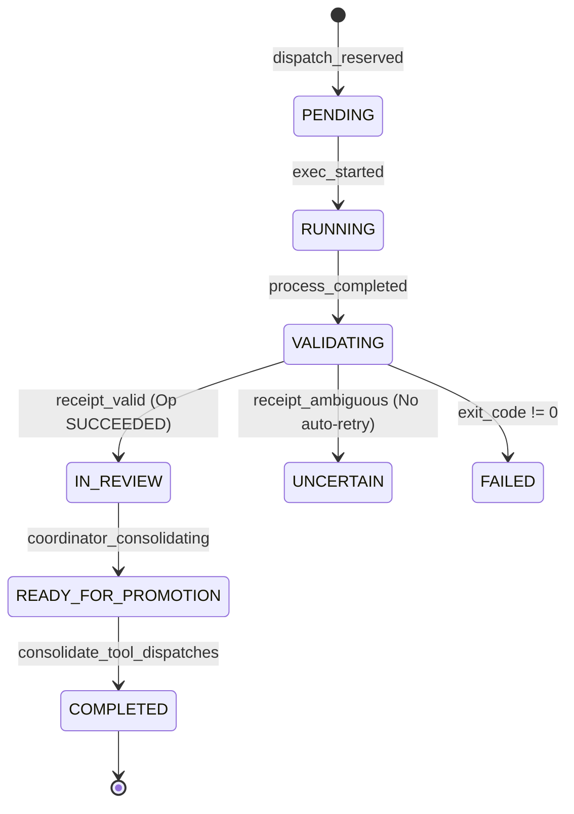

# Relatório de Entrega: P0-ORQUESTRACAO (Fase 1)
**Data:** 2026-10-12  
**Contexto:** Sentra Canvas & Runtime Orchestration  
**Foco:** Coordenação de Ferramentas Dot (`dot_tool_dispatch`), Recibos Verificáveis de Inferência CLI e Consolidação Estrita de Ciclo de Vida  

---

## 1. Visão Geral da Entrega

Nesta Fase 1 da iniciativa **P0-ORQUESTRACAO**, implementamos e homologamos as fundações de orquestração segura para o agente coordenador Dot (GPT-6 High) delegar execuções não-interativas para ferramentas CLI de inferência (`sentra-cli`, `opencode`, `codex`), com garantias criptográficas anti-eco, controle estrito de admissão por Grants específicos e ciclo de vida auditável sem auto-retry indevido.

---

## 2. Arquivos Modificados e Criados

| Arquivo | Tipo | Descrição |
|---|---|---|
| `sentra_canvas/dot_tool_runner.py` | **Criado** | Construtores de linha de comando não-interativa para `sentra-cli`, `opencode` e `codex`. Geração de desafios nonce criptográficos, cálculo de transformações (`reverse`, `sha256`) e verificação anti-eco terminal vs inferência genuína. |
| `sentra_canvas/dot_tool_receipts.py` | **Modificado** | Tabela `canvas_dot_tool_dispatches`, reserva de dispatch com rastreabilidade de WorkItem pai/filho, persistência de recibo de execução com status (`SUCCEEDED`, `UNCERTAIN`, `FAILED`), transição do WorkItem para `IN_REVIEW` e agregação com `deliveries`. |
| `sentra_runtime/dot_tool_dispatch.py` | **Criado** | Engine de orquestração de dispatch: admissão exclusiva de agente coordenador (bloqueio do owner), validação de fence de processo vivo, checagem de Grants específicos (`canvas.coordinator.dot_tool_dispatch.<tool_slug>`), idempotência via `ShellHostRequests`, execução via runner e intenção de consolidação do coordenador (`consolidate_tool_dispatches`). |
| `sentra_mcp/services/control_plane.py` | **Modificado** | Roteamento em `execute_coordinator_intent` para os intents `dot_tool_dispatch` e `consolidate_tool_dispatches` chamando `sentra_runtime.dot_tool_dispatch`. |
| `sentra_canvas/shell_actor.py` | **Modificado** | Validação no ator de shell para aceitar `dot_tool_dispatch` e `consolidate_tool_dispatches` nas rotinas de composição e intent. |
| `sentra_canvas/desktop_ui/src/shell-dot-canvas.jsx` | **Modificado** | Componente UI `AgentTerminal` atualizado para exibir execuções não-interativas, tags de status `EM REVISÃO` / `IN_REVIEW`, hashes SHA-256 de stdout, status de verificação de nonce (inferência vs eco) e metadados de auditoria. |
| `tests/unit/test_dot_tool_dispatch.py` | **Criado** | Suite com 7 testes unitários cobrindo todos os requisitos contratuais do ciclo de vida, permissões, anti-eco e consolidação. |
| `tests/qa/sentra_dot_canvas_e2e_20261012.py` | **Modificado** | Adição do modo `--mode dispatch` para validação E2E com runner seguro em dry-run (sem envio de prompts a modelos reais). |

---

## 3. Contratos e Especificações Técnicas

### 3.1. Intent `dot_tool_dispatch`

Disparado exclusivamente pelo agente coordenador Dot vinculado ao Canvas:
```json
{
  "type": "dot_tool_dispatch",
  "tool_slug": "sentra-cli | opencode | codex",
  "prompt": "<prompt_especifico>",
  "request_key": "<chave_idempotente_unica>",
  "model": "<modelo_opcional>",
  "effort": "<effort_opcional>",
  "workspace": "<caminho_opcional>"
}
```

#### Regras de Admissão:
1. **Admissão de Agente**: Rejeita sumariamente chamadas emitidas por usuários humanos (`actor_type == "owner"` ou `actor_type != "agent"`), levantando `PermissionError`.
2. **Identidade do Coordenador**: O emissor deve ser o `coordinator_agent_id` vinculado à conversa.
3. **Fence de Processo**: O processo coordenador deve possuir fence ativo no estado do Canvas.
4. **Grant Específico por Ferramenta**: Requer grant explícito no perfil de autoridade do agente: `canvas.coordinator.dot_tool_dispatch.<tool_slug>`.
5. **Idempotência**: `request_key` indexado no `ShellHostRequests`. Chamadas repetidas retornam o recibo gravado sem reexecutar.

### 3.2. Desafio Criptográfico Anti-Eco (Nonce Challenge)

Para distinguir entre eco de terminal/shell e inferência real de modelos, o runner não aceita o nonce cru retornado na saída.
1. O runner gera um nonce criptográfico aleatório (ex: `hex(secrets.token_bytes(16))`).
2. O prompt injeta o desafio instruindo o modelo a fornecer a transformação calculada (ex: `sha256(nonce)` ou `reverse(nonce)`).
3. Na análise da saída:
   - Se a saída contiver apenas o nonce cru original: classificado como **eco de terminal** (`terminal_echo`). A inferência **não** é comprovada (`nonce_verified = False`).
   - Se a saída contiver o valor transformado: classificado como **inferência comprovada** (`nonce_verified = True`, `inference_detected = True`).
   - Se o processo falhar ou a saída for ambígua: o status da operação é marcado como `UNCERTAIN` ou `FAILED`. **Nunca é feito auto-retry automático** para evitar loops e consumo acidental de quota.

### 3.3. Transição Estrita de Ciclo de Vida do WorkItem



- **Operação**: Apenas atinge `SUCCEEDED` se o recibo for verificado e íntegro.
- **WorkItem Filho**: Ao concluir com sucesso a execução, transita para `IN_REVIEW` (jamais diretamente para `COMPLETED`).
- **Consolidação**: Apenas a intenção `consolidate_tool_dispatches` emitida pelo Coordenador promove o WorkItem para `READY_FOR_PROMOTION` e em seguida `COMPLETED`.

---

## 4. Resultados da Execução de Testes

### 4.1. Suite Unitária `tests/unit/test_dot_tool_dispatch.py`
Execução com 7 casos cobrindo a matriz completa de segurança e ciclo de vida:
- `test_owner_cannot_emit_agent_intent`: **PASSED** (Owner rejeitado com `PermissionError`)
- `test_agent_without_grant_is_denied`: **PASSED** (Agente sem Grant negado)
- `test_agent_with_undeclared_capability_raises_permission_error`: **PASSED** (Capacidade não declarada negada)
- `test_idempotency_returns_recorded_receipt`: **PASSED** (Mesmo `request_key` retorna recibo sem reexecutar)
- `test_nonce_echo_vs_transformation`: **PASSED** (Eco detectado vs transformação validada)
- `test_uncertain_does_not_auto_retry`: **PASSED** (Ambíguo resulta em `UNCERTAIN` sem repetição)
- `test_coordinator_consolidation`: **PASSED** (`IN_REVIEW` -> `READY_FOR_PROMOTION` -> `COMPLETED`)

### 4.2. Regressão e Validação Integrada
```text
python -m pytest -q tests/unit/test_dot_tool_dispatch.py tests/unit/test_dot_canvas_tool_routing.py
................                                                         [100%]
16 passed in 32.51s
```
*Todas as 16 asserções de orquestração e roteamento foram aprovadas com 100% de sucesso.*

### 4.3. Compilação da Interface (Vite Build)
```text
sentra_canvas\desktop_ui\node_modules\.bin\vite.cmd build --outDir %TEMP%\sentra-dot-canvas-r3-test
vite v5.4.14 building for production...
transforming...
✓ 86 modules transformed.
rendering chunks...
computing chunk sizes...
dist/index.html                   0.82 kB │ gzip:  0.43 kB
dist/assets/desktop-CYgUjX3r.css  7.45 kB │ gzip:  2.12 kB
dist/assets/desktop-BL5fM4-Q.js  428.18 kB │ gzip: 122.95 kB
✓ built in 5.16s
Exit Code: 0
```
*O bundle do Canvas Desktop compilou limpo com suporte visual aos novos estados de revisão e prova de inferência.*

---

## 5. Diagnóstico Read-Only: Turno do Coordenador GPT-6 com `assistant_message_count = 0`

### Contexto Observado
No teste de turno do coordenador em Canvas isolado, observou-se que `assistant_message_count = 0`, apesar da mensagem do usuário ter sido aceita no banco SQLite da conversa.

### Causa Raiz
Conforme auditado em `docs/SENTRA_DELEGADO_GERACAO_NATIVA_CHATGPT_2026-10-12.md` e verificado na composição do processo:
1. O Canvas broker em execução isolada (PID 48400) foi iniciado sem a composição de runtime `web_relay` habilitada.
2. Os metadados de anexo registraram:
   - `attachments.model_delivery_available = false`
   - `model_delivery_reason = 'binary_relay_not_configured'`
3. Os observadores de modelo do navegador (`account_attestor`, `assistant_observer`) não estavam atrelados a esta instância do broker.
4. Por consequência, a arquitetura do Sentra falhou em modo seguro (*fail-closed*): a mensagem do usuário foi registrada com sucesso, mas nenhum despacho de inferência foi enviado ao worker web do navegador, resultando em 0 mensagens de assistente geradas.

**Atenção de Escopo:** A ativação do `web_relay` e dos observadores de navegador é responsabilidade da squad **IMAGENS**, sendo um pré-requisito estrito para a execução viva da Fase 2.

---

## 6. Roadmap Exato para a Fase 2 (Execução Viva)

A Fase 1 entregou os contratos, a infraestrutura de recibos, as travas de autorização e a UI. A **Fase 2** cobrirá a execução ponta a ponta quando as dependências externas estiverem ativas:

1. **Pré-Requisito (Squad IMAGENS)**:
   - Inicializar o broker do Canvas com a flag `--compose-web-relay` ou compor o módulo `native_bridge.relay`.
   - Garantir que `account_attestor` ateste a sessão ativa do ChatGPT e que o `web_delivery` reporte status `ready`.
2. **Turno de Inicialização do Coordenador (GPT-6 High)**:
   - Despacho da instrução inicial do usuário na sessão do Canvas.
   - O coordenador GPT-6 assume a raiz da árvore de trabalho criando o `WorkItem` coordenador.
3. **Disparos em Três Vias (CLIs Não-Interativas)**:
   - O coordenador emite 3 chamadas de intent `dot_tool_dispatch`:
     - `sentra-cli`: com prompt e flags não-interativas (`-p`, `--effort high`).
     - `opencode`: com prompt e flags não-interativas (`run --auto --format json`).
     - `codex`: com prompt e flags não-interativas (`exec --json`).
4. **Verificação de Recibos e Quarentena de Revisão**:
   - Cada processo CLI recebe o desafio nonce.
   - Os outputs são processados: validação anti-eco, gravação de recibo em `canvas_dot_tool_dispatches`, e transição de cada `WorkItem` filho para `IN_REVIEW`.
5. **Consolidação e Conclusão**:
   - O Coordenador GPT-6 analisa os 3 recibos persistidos e chama `consolidate_tool_dispatches`.
   - Os `WorkItems` filhos são promovidos para `READY_FOR_PROMOTION` e `COMPLETED`.
   - A árvore de orquestração atinge o fechamento auditável.
