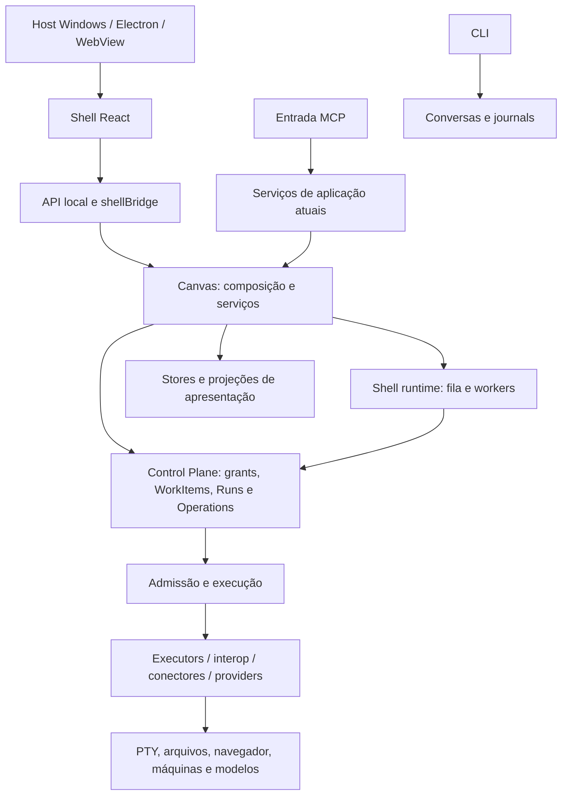

# Análise estrutural do SENTRA — 23/10/2026

## Conclusão

O SENTRA já tem uma arquitetura de autoridade e continuidade importante:
grants duráveis, journal anterior ao efeito, separação entre conversa e execução,
ownership de processos e recursos que sobrevivem à janela. A estrutura de
implementação ainda não torna essas fronteiras suficientemente claras.

As prioridades são separar composição de layout e controle, explicitar contratos
entre features e transports, reduzir dependências entre implementações concretas
e tornar persistência, recuperação e evidência mais fáceis de compreender.
Organizar pastas deve acompanhar essas mudanças, e não substituí-las.

Esta etapa entrega análise, mapa, proposta e sequência de trabalho. Não moveu
módulos nem alterou execução, dados, permissões, sessões, layout ou instaladores.

## Escopo, método e limitações

Três frentes complementares examinaram o checkout:

- Frontend: templates, páginas, features, estado, lifecycle, estilos e legado.
- Backend: autoridade, aplicação, persistência, efeitos e contratos de recuperação.
- Síntese: inventário estático, dependências, builds, testes, distribuição,
  documentação e modelos reutilizáveis de projeto/agente.

Foram usadas as skills UI/UX Pro Max, Frontend Design e Impeccable para a parte
de interface. A análise de arquitetura se baseia no código, nos contratos e nas
evidências, sem tratar recomendações de aparência como regras de backend.

O inventário usa arquivos rastreados, lidos da árvore de trabalho atual. Não é
um snapshot imutável do HEAD; já existiam mudanças concorrentes. As contagens
são físicas, não linhas executáveis. Imports Python foram analisados por AST,
incluindo imports adiados em funções; os exclusivos de TYPE_CHECKING foram
excluídos do grafo de runtime. Imports dinâmicos e ciclos JavaScript não foram
modelados. Mídias, HTML e outros formatos não entram nas contagens de código.

A revisão aprofundada se concentra nas entradas, contratos e pontos de maior
acoplamento. Inventariar o repositório inteiro não equivale a revisar semanticamente
cada linha. Não foram executadas as suítes completas nem nova qualificação de
instalação, concorrência, produção ou desempenho. A análise visual anterior está
em [interface-audit-2026-10-23.md](../design/interface-audit-2026-10-23.md).

## Dimensão observada

| Medida | Resultado | Interpretação |
| --- | ---: | --- |
| Arquivos rastreados existentes | 2.614 | Universo do inventário |
| Arquivos medidos | 2.033 | Python, JS/JSX/TS/TSX/MJS/CJS, CSS e PowerShell |
| Código classificado como próprio | 902 arquivos | Exclui vendor, testes e outputs identificados |
| Arquivos de teste medidos | 755 | Arquivos, não quantidade de casos executados |
| Outputs gerados identificados | 122 | Principalmente desktop-assets e nomes minificados |
| Código vendor identificado | 47 arquivos | Mantido separado do código próprio |
| Projetos Node com package.json | 9 | Existem responsabilidades e plataformas diferentes |
| Fontes medidas em desktop_ui/src | 181 arquivos | Inclui 12 arquivos vendor; assets não entram |
| Fontes diretamente em src | 130 arquivos | Concentração horizontal de módulos shell-* |
| Maior grupo cíclico entre pacotes Python | 19 raízes | Acoplamento estático; não prova erro de import em execução |

As raízes sentra_canvas e sentra_mcp concentram aproximadamente 45.607 e 38.137
linhas físicas medidas, respectivamente, sem os testes, outputs e vendor
identificados. O tamanho serve para escolher pontos de inspeção, não como
diagnóstico isolado.

| Ponto de concentração | Medida | Responsabilidades observadas |
| --- | --- | --- |
| Canvas, service.py | 2.692 linhas; 115 métodos na classe Canvas | Composição, recursos, rotas de aplicação, agentes, processos e shutdown |
| ControlPlaneService | 1.776 linhas; 107 métodos | Composição e numerosos casos de uso e projeções |
| DurableRunService | 2.424 linhas; 58 métodos | Schema, transições, intenção, journal e estado durável |
| shell-app.jsx | 1.006 linhas; 49 useState e 17 useEffect | Layout, navegação, dados, recuperação, presença e páginas |
| shell-conversation.jsx | 737 linhas; 36 useState e 16 useEffect | Histórico, stream, envio, rascunho, anexos e permissões |
| main.jsx | 546 linhas; 33 useState e 6 useEffect | Bootstrap, grafo ancestral, pool, projeto, painéis e diálogos |

As chamadas React são contagens textuais. Código comprimido em poucas linhas,
como partes de DotWorkspace, também exige separação de responsabilidades.

## Como o programa está organizado hoje

Este é um mapa de responsabilidades, não uma declaração de que as dependências
seguem somente as setas. Há imports no sentido inverso, descritos adiante.

| Grupo atual | Função predominante | Separação necessária |
| --- | --- | --- |
| sentra_canvas/desktop_ui | Interface React e workspace | Layout, páginas, features, controladores e infraestrutura |
| sentra_canvas Python | Host, HTTP, recursos e projeções | Bootstrap, adapters HTTP, casos de uso e repositories |
| sentra_mcp | Entrada MCP e grande parte da aplicação/autoridade | Transporte separado dos serviços reutilizados por outras entradas |
| sentra_core | Identidade, conversas e contabilização | Contratos puros separados de persistência e serviços concretos |
| sentra_runtime | Admissão, políticas, execução e composição de máquinas | Contratos do host separados da implementação Canvas |
| sentra_executors / sentra_interop / sentra_connectors | Efeitos e integração com protocolos | Portas explícitas, ownership e resultados uniformes |
| orchestrator / sentra_model_gateway | Coordenação e transporte de modelos | Preservar fronteiras de entrega e evidência |
| sentra_electron / native_app / remote.desktop | Apresentação nativa e supervisão | Distinguir display, broker e centro de controle |
| integrations | Terminal, mobile e integrações pinadas | Separar código compartilhado próprio de integração e vendor |
| scripts/commander / installer / workflows | Build, staging, instalação e entrega | Comandos descobríveis e perfis explícitos de validação |

## Templates: três separações diferentes

### Templates de interface

Falta uma camada explícita entre primitivas como Modal/Field e as páginas do
produto. Hoje, Home e listagens estão no shell; conversa e workspace constroem
seus próprios cabeçalhos, wrappers, rolagens, estados e regiões auxiliares.

| Template proposto | Regiões estáveis | Responsabilidade que fica fora |
| --- | --- | --- |
| AppShell | Navegação, topbar, presença, notificações, conteúdo, inspector e overlays | Consultar entidades e executar ações de negócio |
| CatalogLayout | Título, ação principal, filtros, coleção, paginação | Conhecer Dots, Spaces ou endpoints |
| ConversationLayout | Cabeçalho, conexão, histórico rolável, compositor e recurso lateral | Admission, stream e recuperação de envio |
| DockLayout | Toolbar, abas, divisões e hosts de painéis | Criar, autorizar ou encerrar processos |
| DocumentLayout | Navegação de arquivos, editor, ferramentas e detalhes | Persistência do documento e grants |
| SettingsLayout | Seções, formulário, feedback e ações | Política de acesso ou instalação de integrações |

Cada template precisa definir alturas, overflow, landmarks, foco e comportamento
estreito. Estados de vazio, erro, carregamento e pendência devem ser componentes
comuns, alimentados por um estado de apresentação explícito.

As páginas compõem features dentro desses templates. Os controladores cuidam de
dados e efeitos; o layout recebe conteúdo e callbacks. Isso permite melhorar a
composição sem tocar na autoridade ou no lifecycle de processos.

### Modelos de projeto, agente e rotina

Já há blueprints de governança, não apenas referências visuais. ControlPlaneService
exporta em control_plane.py:1037 e valida/importa a partir de :1244/:1282.
O formato possui versão, exige contains_secret_values=false e oferece dry_run.
Autorização continua nos grants: authorization.py:3 esclarece que papel/template
não é outra fonte de autoridade. Essa é uma boa separação a preservar.

Uma organização mais clara pode distinguir:

- Blueprint de projeto: objetivos, papéis, capacidades requeridas e rotinas.
- Preset de Dot: papel, instruções, preferências e requisitos de modelo.
- Perfil de workspace: composição de painéis e referências a recursos existentes.
- Instância: IDs reais, revisões, bindings, grants e recursos admitidos pelo host.

Um template declara necessidades e preferências; instanciá-lo produz um plano
validável. As referências reais são resolvidas pelo host. Exportar/importar layout
não deve criar terminais nem transportar segredos ou permissões implícitas.

### Referências externas e protótipos

Dependências externas, componentes adaptados e protótipos têm papéis diferentes. Já há
pins, hashes, licenças e inventários, como [component source inventory](../../THIRD_PARTY_NOTICES.md).
Essas origens devem ser rastreáveis sem se tornarem três sistemas visuais ativos.

Identificar explicitamente o que é produção, compatibilidade, experimento e
vendor evita que uma prévia ou referência vire dependência de runtime por acidente.
Nem duas ilhas de presença nem dois Canvas são automaticamente duplicação:
há displays distintos, fallback e mapa reutilizado dentro do workspace.

## Achados estruturais prioritários

P1 indica impacto alto sobre a confiança, recuperação ou evolução do programa;
P2 indica dívida de manutenção e clareza. Não foram atribuídos P0 nem declaradas
falhas de segurança ou perda de dados em produção sem reprodução.

### A1 — P1: evidência agrega afirmações de forças diferentes

**Fato:** dot_tool_runner.py:133/:211 aceita exit code zero e transformação
determinística de nonce para marcar verified. O modelo efetivo pode ser inferido.
dot_tool_dispatch.py:394 transforma esse resultado em live_model_verified para
o caminho de processo nativo. Runners injetados são corretamente diferenciados.

**Experimento controlado:** somente as duas funções puras foram avaliadas com
dados sintéticos. Uma string construída localmente com REVERSE_NONCE correto
produziu verified=true e um effective_model padrão. Não houve processo, chamada
de modelo ou acesso a credenciais. Isso mostra o alcance do verificador isolado,
não um bypass reproduzido no fluxo completo de produção.

**Separação proposta:** diferenciar processo observado, desafio respondido,
identidade de provider/modelo confirmada e objetivo de tarefa verificado. O hash
do stdout atesta integridade do conteúdo; não acrescenta proveniência por si só.
Estados de apresentação e gates devem consumir a evidência apropriada.

**Aceite:** uma resposta sintética pode satisfazer o desafio, mas não atestar
modelo real. Evidência de provider deve ser vinculada à Operation, sem poder
ser reutilizada por outro contexto.

### A2 — P1: alterações de entidades atravessam commits separados

**Fato:** shell_runtime.py:387 atualiza agente local, contexto e metadados duráveis.
shell_coordinator.py:696 chama esse caminho e :789 persiste o Dot posteriormente.

**Risco:** interrupção entre commits pode deixar revisões e instruções divergentes.
A interrupção não foi reproduzida nesta etapa. O journal existente retém incerteza
e impede replay; essa proteção não equivale, sozinha, a reconciliar projeções.

**Separação proposta:** um caso de uso com revisão desejada, fases persistidas e
reconciliação por identidade. A convergência não deve reenviar prompts, reiniciar
processos ou inventar uma segunda intenção.

**Aceite:** injetar falha após cada gravação e comprovar convergência ou diagnóstico
explícito após reabertura, com a chave original e sem nova execução.

### A3 — P1: o shell é layout, controlador e conjunto de páginas

**Fato:** shell-app.jsx administra navegação, presença, dados, recuperação e páginas.
O efeito em :563 consulta Space, Dots, conversas e documentos; suas dependências
em :579 incluem islandEnabled e nativePresence. Uma preferência de apresentação
pode reiniciar esse ciclo de consulta e limpar estado intermediário.

**Separação proposta:** AppShell visual; controladores de escopo, catálogo,
atividade, navegação e resolução de conversa; páginas de produto independentes.
Extrair por lifecycle, e não criar um hook para cada função.

**Aceite:** mudar presença não invalida catálogos sem necessidade; consultas de
outro projeto/Space não substituem a tela atual; navegação continua bloqueando
saída quando um rascunho ou operação exige tratamento.

### A4 — P1: montagem visual e vida dos recursos precisam de contrato explícito

**Fato:** main.jsx:332 mantém o shell dentro de WorkspaceDesktop, que possui o
pool e o controlador do grafo ancestral. O polling do grafo em :270 é periódico
e não é limitado pela vista do shell. Conversa reúne stream, fallback, histórico,
envio e permissões em shell-conversation.jsx:87/:98/:197/:239/:392.

Canvas, documentos, chat e abas do workspace usam políticas diferentes de
montagem, hidden e retenção. Há boas razões para essas estratégias, mas elas
estão distribuídas entre shell-app.jsx:173/:932 e DotWorkspace.jsx:38/:189.

**Separação proposta:** um provider de runtime possui o pool; páginas possuem
visualizações. Histórico, stream, envio e rascunho têm controladores distintos.
Hosts estáveis dos painéis continuam preservando identidade ao mover/maximizar.
O grafo legado e seus atalhos ficam isolados.

**Aceite:** fechar aba não encerra PTY, mover painel não cria outra sessão,
restaurar layout não executa ações, e um envio incerto preserva sua intenção.
Concorrência de atalhos entre o grafo e o workspace é hipótese para teste,
não uma falha já reproduzida; custo do polling não foi medido.

### A5 — P2: fronteiras de pacote dependem de implementações concretas

**Fatos representativos:**

- sentra_core/provider_usage.py:7 importa serviços concretos de governança e budget.
- sentra_core/conversations.py:20 depende da infraestrutura de segredos remotos;
  :97 resolve binding por runtime.
- sentra_runtime/canvas_authority.py:2 herda de TaskRuntime do pacote Canvas.
- sentra_runtime/central_authority.py:19 depende do serviço durável sob MCP.
- sentra_runtime/shell_optional_authority.py:32 conhece CanvasShellRuntime concreto.

O grafo estático forma um grupo de 19 raízes e outro de 95 módulos mutuamente
alcançáveis. Muitos imports são adiados; isso não demonstra erro circular de
inicialização. Mostra que a separação por diretório não garante independência.

**Separação proposta:** contratos de contexto autorizado, execução, recibos e
armazenamento protegido; adapters confiáveis e composição no host. Primeiro
injetar dependências e manter fachadas; só depois decidir mudanças físicas.

**Aceite:** um objeto que imita métodos/atributos não adquire autoridade; owner,
store e escopo divergentes continuam negados; SQLite e PostgreSQL mantêm semântica.

### A6 — P2: schemas e consultas têm ownership distribuído

**Fato:** diferentes serviços introduzem tabelas no namespace shell. Em
workspace_presentation.py:46, a leitura passa por CREATE TABLE e BEGIN IMMEDIATE.
workspace_file_editor.py:78 tem comportamento semelhante. provider_usage.py:90
também conhece schemas de outros bancos por ATTACH DATABASE.

**Risco:** migração e consulta participam do mesmo caminho de escrita, tornando
ownership e contenção mais difíceis de analisar. Não houve medição de bloqueios.

**Separação proposta:** migrations explícitas e versionadas por namespace;
repositories proprietários das tabelas; portas de consulta e projeção para
consumidores externos. Preservar a fonte central de autoridade e os codecs.

**Aceite:** após bootstrap, uma consulta não altera schema ou revisão; migration
parcial/concorrente e versão futura têm comportamento claro e rollback compatível.

### A7 — P2: fachadas acumulam composição, dispatch e lifecycle

**Fato:** Canvas concentra famílias de recursos, composição e shutdown. O handler
POST em __main__.py:453 também faz dispatch extenso. ControlPlaneService compõe
serviços e oferece numerosos casos de uso no mesmo objeto.

**Separação proposta:** composition root explícito; handlers por família;
serviços de aplicação injetados; repositories e adapters separados. Uma fachada
compatível permite migração gradual sem mudar o protocolo público de uma vez.

**Aceite:** mesmas rotas e envelopes, mesmos limites de payload e admissão;
shutdown mantém leases/ownership enquanto houver efeito físico em andamento.
Não criar um serviço genérico que apenas transfira o mesmo acoplamento.

### A8 — P2: navegação e tipos já divergiram entre representações

**Fato:** network aparece nos títulos do shell e em WORK_VIEWS, mas não em
restoreNavigation. Fontes: shell-app.jsx:41, shell-navigation.js:16,
shell-bridge.js:132. A restauração por esse caminho cai em Home.

WorkspaceTab em workspace/contracts.ts:6 não descreve conversationId e
executionWorkspaceId, usados em DotWorkspace.jsx:132 e aceitos em layout.js:12.
O contrato do desktop também importa tipos de dentro da integração mobile.

**Separação proposta:** registro canônico de vistas e contrato versionado de
apresentação/escopo. Compartilhar contratos próprios em um lugar independente
de uma plataforma consumidora. Validadores de runtime continuam obrigatórios.

**Aceite:** todas as vistas persistíveis fazem round-trip; serialização de abas
aceita exatamente os campos previstos, sem converter preferências em autoridade.

### A9 — P2: erros perdem semântica entre HTTP e MCP

**Fato:** __main__.py:231 converte ShellConflict em erro de revisão, embora
shell_requests.py:383 também use a exceção para colisão de chave de intenção.
native_canvas.py:76 reduz rejeição HTTP a RuntimeError com status. Há um envelope
mais rico em sentra_mcp/errors.py:38.

**Separação proposta:** resultados de aplicação com códigos estáveis, traduzidos
por cada transporte. Distinguir conflito de revisão, intenção diferente, consulta
falha, rejeição antes da admissão e efeito possivelmente ocorrido.

**Aceite:** os transports preservam identidade, categoria e orientação de
recuperação. A UI não decide se deve repetir uma operação pelo texto do erro.

### A10 — P2: estilos e bridges imperativos têm contratos implícitos

**Fato:** main.jsx:30 carrega três camadas de CSS com redefinições dos mesmos
tokens. adaptador visual também traduz tokens de outras features. O
catálogo shell-design-tokens.js lista nomes, mas não centraliza os valores.

InspectorPortal e openInspector dependem de IDs globais e alteração imperativa
do DOM: main.jsx:525, shell-app.jsx:981, panels.js:10. Há proteções de geração
e escopo que devem continuar existindo.

**Separação proposta:** tokens canônicos com aliases temporários; estilos locais
e de layout; adapter explícito mount/update/dispose para o inspector legado.
Extrair PtySlot de nodes.jsx:10 para a feature de terminais evita que o host de
terminal dependa de um arquivo de nós ReactFlow.

**Aceite:** cada template renderiza em ambos os temas e em portais; a migração
remove a regra antiga correspondente em vez de acrescentar outra camada global.

### A11 — P2: a validação do frontend atual precisa de uma entrada previsível

**Fato:** desktop_ui/package.json contém build e preview, mas não test, lint ou
typecheck. Há 75 arquivos rastreados em test/, incluindo testes de navegação,
stream, recuperação, layout e fixtures. A ausência de script não significa
ausência de testes.

No CI principal, test_canvas.ps1 verifica scripts e E2E das superfícies antigas.
As instalações npm explícitas do job Python são terminal e transporte mobile;
não há etapa explícita de instalar/buildar o shell React nesse workflow. Existem
testes React via pytest, como test_sentra_cos_canvas_ux_browser.py, mas a fixture
salta quando falta Vite. A release instala e compila o desktop separadamente.

**Separação proposta:** comando único para testes do shell e job explícito no CI
obrigatório, preparando dependências e falhando se a cobertura essencial for
saltada. Separar testes de modelo puro, contrato de bridge e UI renderizada.
Ampliar tipagem incrementalmente nas fronteiras; o mypy atual fiscaliza cinco
alvos e não equivale a tipagem integral de todo o projeto.

**Aceite:** um PR que altera Home, navegação, conversa ou workspace executa
verificação do renderer e contratos de recuperação sem depender de uma release.
Não foram consultados resultados remotos de CI nesta revisão.

### A12 — P2: fonte, entrega e documentação operacional merecem escopos distintos

**Fato:** nove projetos Node têm comandos e dependências separados, sem manifesto
de workspace ou ferramenta raiz de tarefas identificados. Isso pode ser válido
para plataformas independentes, mas falta uma entrada clara por perfil de trabalho.

Assets gerados são versionados e selados. build_canvas.py:15 e source-inputs.mjs
calculam o mesmo inventário em linguagens diferentes; existe teste de paridade.
Isso é uma proteção existente, não uma duplicação a remover sem substituição.

build_windows.py:823 copia todo docs/ para o payload. Só os documentos rastreados
somam 294 arquivos e cerca de 21,94 MiB, incluindo relatórios e dados internos de
auditoria. O README do frontend ainda abre descrevendo a direção Maestri,
enquanto a entrada atual usa shell e estilos da camada visual.

**Separação proposta:** comandos por perfil desktop/backend/mobile/integrations;
mapa arquitetural atual separado do histórico; catálogo explícito de docs que
precisam ser distribuídos. Qualquer mudança no payload precisa atualizar selos,
proveniência e testes, preservando licenças e guias obrigatórios.

**Aceite:** uma pessoa consegue identificar fonte, entrada, comando de teste,
output e proprietário de cada parte. A instalação recebe a documentação destinada
ao usuário, com integridade verificável.

## O que já está bem separado

- Broker persistente independente da janela: broker.py:1 e electron_host.py:1.
- Electron como display restrito, sem se tornar executor: sentra_electron/main.cjs:2.
- Pool de terminais separado da renderização e funções puras de layout.
- Journals de intenção, request_key, revisões e reconciliação conservadora.
- Distinção entre projeção visual/contexto e autoridade de execução.
- Grants e gates centrais; importação de blueprint não concede confiança implícita.
- Pins, hashes, licenças e validação de fonte/output na cadeia de build.
- Testes existentes de no-replay, fencing, efeitos tardios e recuperação.

## Sequência recomendada

1. Registrar contratos de erro, evidência e lifecycle; caracterizar os casos de
   recuperação antes de alterar módulos críticos.
2. Tornar os testes do shell atual uma etapa descoberta e obrigatória por PR.
3. Unificar vistas e contratos de apresentação; extrair templates e páginas de
   catálogo com os mesmos controladores e callbacks inicialmente.
4. Extrair o provider de runtime de main.jsx e separar os controladores do shell
   e da conversa, preservando o pool e a intenção original de cada envio.
5. Introduzir portas entre core, control plane, host e adapters; manter fachadas
   de compatibilidade e executar testes contratuais em cada migração.
6. Formalizar ownership de schema e reconciliação entre commits; separar
   bootstrap/migrations do caminho de consulta.
7. Consolidar estilos por componente migrado e reorganizar documentação/build
   somente com os selos e consumidores atualizados.

A estrutura proposta de pastas, regras de dependência e critérios de aceite está
em [TARGET_STRUCTURE.md](TARGET_STRUCTURE.md). A ordem considera risco: mover
pastas de terminais, journals ou autoridade antes de caracterizar seus contratos
pode tornar a árvore mais bonita e o programa menos confiável.

## Verificações realizadas

| Verificação | Resultado |
| --- | --- |
| AST dos arquivos Python inventariados | Nenhum SyntaxError observado |
| Contrato de fonte e supply chain | Passou: SENTRA_CICD_CONTRACT_OK |
| Validação read-only do bundle desktop existente | Recusou divergência entre source_inputs e a árvore atual |
| Experimento de semântica de recibo | Transformação sintética foi aceita pela função pura, sem inferência |
| Revisão independente frontend/backend | Concluída; alegações relevantes conferidas na síntese |

O bundle divergente é um estado do checkout observado durante desenvolvimento
concorrente. O gate detectou a divergência como deveria; isso não prova que o
instalador distribuído está errado. Não foi executado rebuild para sobrescrever
artefatos durante esta análise.

Evidências: [structure.json](evidence/2026-10-23/structure.json),
[verification.json](evidence/2026-10-23/verification.json),
[receipt-semantics.json](evidence/2026-10-23/receipt-semantics.json).
