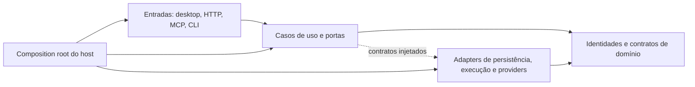

# Estrutura proposta para o SENTRA

Proposta derivada da [análise de 23/10/2026](STRUCTURAL_AUDIT_2026-10-23.md).
Ela define responsabilidades e direção de evolução. Não representa módulos já
extraídos nem autoriza alterar o comportamento de execução durante movimentos.

## Regras de dependência



A seta tracejada representa colaboração em execução por interfaces; a aplicação
não precisa importar as implementações concretas para chamar essas interfaces.
O host confiável compõe os objetos e continua responsável pelo escopo de autoridade.

| Responsabilidade | Deve conhecer | Deve receber por contrato |
| --- | --- | --- |
| Domínio | Identidades, valores, invariantes e resultados | Persistência, segredo protegido, transporte e relógio quando necessários |
| Aplicação | Casos de uso, políticas e estados de execução | Authority store, repositories, executors e publishers |
| Transportes | Envelope HTTP/MCP/CLI, autenticação da entrada e tradução de erros | Casos de uso já compostos e principal confiável |
| Persistência | Schemas, transactions, codecs e migrations próprios | Contexto e decisões necessários à operação |
| Execução | Recurso físico, exclusão, cancelamento e evidência observada | Intenção admitida, fence, owner e escopo confiáveis |
| Interface | Modelo de apresentação, estado visual e callbacks | Projeções confirmadas e resultados da aplicação |

Não transformar tokens, localStorage, nomes de classes ou campos enviados pelo
cliente em prova de autoridade. Um Protocol ajuda o desacoplamento, mas não
substitui a validação de origem e binding do objeto pelo host.

## Frontend: estrutura inicial recomendada

Manter o projeto Vite existente e migrar uma feature por vez:

```text
sentra_canvas/desktop_ui/src/
  app/
    bootstrap.jsx
    App.jsx
    providers/
      DesktopRuntimeProvider.jsx
      ProjectScopeProvider.jsx
    navigation/
      views.js
      navigation-storage.js
      useShellNavigation.js

  layouts/
    AppShell.jsx
    CatalogLayout.jsx
    ConversationLayout.jsx
    DockLayout.jsx
    DocumentLayout.jsx
    SettingsLayout.jsx

  pages/
    HomePage.jsx
    DotsPage.jsx
    SpacesPage.jsx
    ConversationsPage.jsx
    ConversationPage.jsx
    CanvasPage.jsx
    DocumentsPage.jsx
    NetworkPage.jsx

  features/
    conversations/
      model/
      controllers/
      components/
    dots/
    spaces/
    documents/
    workspace/
      model/
      controllers/
      panels/
      components/
    terminals/
      TerminalPool.js
      PtyHost.jsx
    presence/
      model/
      embedded/
      desktop/

  infrastructure/
    api/
    shell-bridge/
    persistence/
    native/

  shared/
    ui/
    feedback/
    styles/
      tokens.css
      themes.css
      foundations.css

  legacy/
    desktop/
    inspector/

  qa/
```

Páginas compõem features; features usam modelos, controllers, infraestrutura e
primitivas. Shared/ui não conhece projeto, conversa ou shellBridge. Modelos puros
não importam React/DOM. Evitar pastas globais de hooks/utils sem responsabilidade.

Um template expõe slots e limites de interação:

```jsx
<AppShell
  navigation={navigation}
  topbar={topbar}
  presence={presence}
  notifications={notifications}
  inspector={inspector}
  overlays={overlays}
>
  <SurfaceBoundary scope={scope} state={surfaceState}>
    <Page />
  </SurfaceBoundary>
</AppShell>
```

Esse exemplo é um contrato conceitual. SurfaceBoundary não deve desmontar
indiscriminadamente hosts estáveis quando muda um estado de consulta.

## Ownership de estado e lifecycle

| Tipo de estado | Proprietário | Persistência | Ao ocultar uma tela |
| --- | --- | --- | --- |
| Grants, WorkItems, Runs, Operations | Autoridade central | Store durável existente | Preservar; UI só consulta |
| Sessão/processo/PTY | Runtime e serviço proprietário | Daemon/journal apropriado | Fechar a visualização não encerra recurso |
| Mensagens confirmadas e recibos | Serviços de aplicação e stores | Durável | Consultar por cursor/identidade |
| Stream e observação | Controller da feature | Cursor e estado de transporte | Suspensão explícita conforme contrato |
| Envio pendente/incerto | Controller de envio e journal | Antes do efeito | Consultar a intenção original; não reenviar |
| Rascunho e anexos | Modelo da conversa | Por escopo e política existente | Preservar ou bloquear saída conforme contrato |
| Perfil de painéis/abas | Modelo de apresentação | Revisão e layout_scope | Mover/ocultar sem criar recursos |
| Foco, menu e hover | Componente/template | Transitória | Restaurar foco e liberar listeners |
| Cache visual | Infraestrutura de apresentação | Opcional e escopada | Indicar obsolescência; nunca conceder autoridade |

## Backend: primeiro separar responsabilidades, depois pacotes

Manter inicialmente os caminhos públicos e introduzir módulos internos com
fachadas de compatibilidade. Abaixo estão fronteiras lógicas, não uma lista de
novos serviços ou uma mudança imediata de diretórios:

```text
contratos de domínio
  identidades, escopos, pedidos, resultados e categorias de evidência

aplicação
  conversa, edição de Dot, workspace, execução e reconciliação
  portas para authority store, repositories, segredo protegido e executors

autoridade e persistência
  grants, leases, fencing, intents, journals e migrations por namespace
  stores concretos SQLite/PostgreSQL com contratos equivalentes

runtime e adapters
  ciclo de execução e ownership de recursos
  executors locais, providers, protocolos, conectores e máquinas

entradas e composição
  HTTP Canvas, MCP, CLI e hosts nativos
  autenticação da entrada, composição confiável e tradução de resultados
```

O namespace sentra_mcp pode continuar oferecendo fachadas enquanto seus serviços
reutilizados são desacoplados do transporte. O mesmo vale para lógica de execução
hoje sob sentra_canvas. Uma futura mudança física deve manter imports de transição,
schemas e contratos públicos até todos os consumidores serem migrados.

## Erros e evidências

Um resultado comum precisa distinguir, no mínimo:

| Categoria | Significado | Recuperação |
| --- | --- | --- |
| validation_rejected | Não foi admitido por entrada inválida | Corrigir intenção antes de nova ação |
| authority_denied | Identidade, grant ou escopo não autorizados | Obter decisão explícita apropriada |
| revision_conflict | Recurso mudou desde a leitura | Consultar a revisão atual |
| intent_conflict | Chave já vinculada a outra intenção | Preservar chave/fingerprint originais e diagnosticar |
| delivery_uncertain | Efeito pode ter ocorrido | Reconciliar por observação da mesma intenção |
| dependency_unavailable | Dependência necessária não disponível | Diagnosticar antes de executar |
| effect_failed | Há evidência de falha de execução | Aplicar política específica de recuperação |

Esses são nomes conceituais para discussão; a implementação deve reutilizar
envelopes existentes quando possível. Não trocar todas as mensagens públicas
por um novo protocolo sem versionamento e compatibilidade.

A evidência também deve distinguir desafio respondido, processo observado,
provider/modelo confirmado e objetivo verificado. Não promover uma categoria
para outra apenas porque um booleano genérico se chama verified.

## Templates e blueprints

Manter o formato versionado já existente de governance blueprint e separar
configuração portável de bindings de uma instância. Uma instanciação segura tem
quatro etapas: validar o documento, resolver requisitos no ambiente de destino,
apresentar o plano e admitir os efeitos pelo fluxo normal de autoridade.

Perfis de workspace devem apontar para recursos existentes ou apresentar lacunas;
um layout restaurado não cria sessões. Presets de agente não carregam grants,
conversas, dispositivos ou segredos reais do ambiente de origem.

## Organização do repositório e ferramentas

Criar uma entrada de desenvolvimento com perfis explícitos para desktop,
backend, mobile e integrações opcionais. Os nove projetos Node não precisam ser
instalados indiscriminadamente para uma mudança de UI.

Separar conceitualmente:

- Código de produção e adapters.
- Contratos compartilhados próprios.
- Vendor com licenças, pins e proveniência.
- Testes determinísticos, contratos, browser e aceitação de distribuição.
- Protótipos e prévias de demonstração.
- Documentação de produto distribuída e relatórios históricos de engenharia.
- Outputs gerados e manifests que os ligam à fonte.

O modelo atual de assets selados pode permanecer durante a reorganização.
Mover arquivos exige atualizar source-inputs, o inventário Python de build,
proveniência, PyInstaller, importadores de fixtures e testes pertinentes.

## Critérios de aceite por fase

| Fase | Entrega revisável | Evidência necessária |
| --- | --- | --- |
| Contratos | Categorias de erro/evidência e matriz de lifecycle | Contraexemplos e testes de no-replay/escopo |
| CI frontend | Comando de testes e job obrigatório do shell | Renderer e contratos essenciais executados, sem skips ocultos |
| Templates | Páginas de catálogo extraídas com slots comuns | Paridade de navegação, foco, tema e layout estreito |
| Controllers | Escopo, stream, envio e rascunho separados | Troca rápida de contexto e recuperação de envio incerto |
| Runtime | Pool e hosts independentes de páginas/legado | Um host/writer por PTY, sem relançamento ao mover/ocultar |
| Backend | Portas, handlers e repositories extraídos | Paridade HTTP/MCP, fences e autoridade preservados |
| Persistência | Migrations e reconciliação explícitas | Falha entre commits, reabertura, versões futuras e rollback |
| Distribuição | Perfis e catálogo de payload/documentos | Selos fonte/output, licenças e qualificação do pacote |

Começar por contratos, navegação e páginas de catálogo oferece mudanças pequenas
e verificáveis. Refatorações de persistência e execução exigem caracterização
mais forte, pois seus invariantes protegem os recursos reais do usuário.
